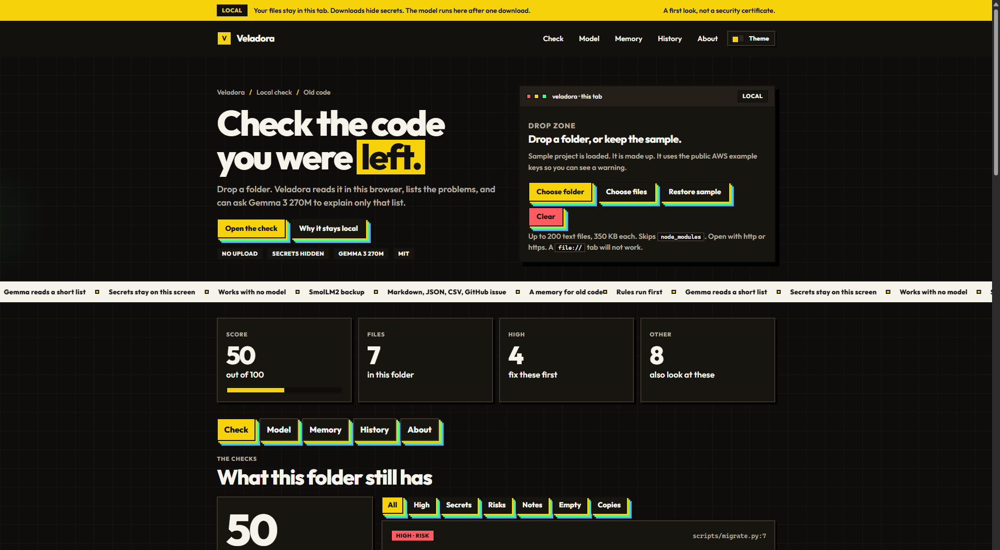
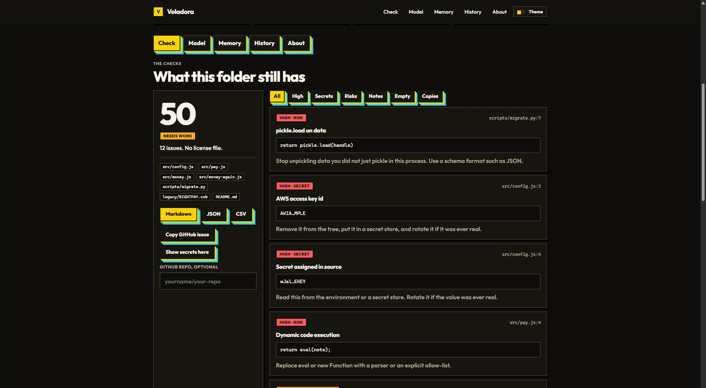
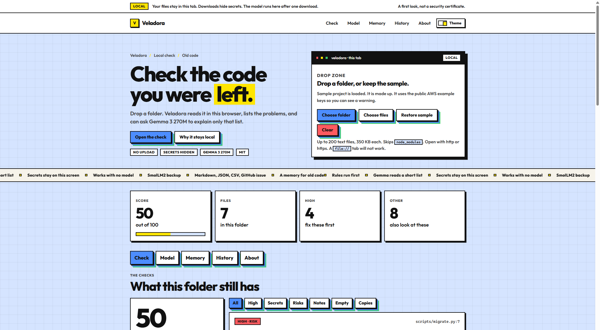

# Veladora

Check old code in your browser. The files stay in the tab.

**Live:** [himanshu-5680.github.io/veladora](https://himanshu-5680.github.io/veladora/) · **Code:** [github.com/Himanshu-5680/veladora](https://github.com/Himanshu-5680/veladora)

Drop a folder. Veladora lists the problems the next person will hit: a key written in a source file, an `eval`, an empty `catch`, a `FIXME` from a contract you were not in the room for, or the same six lines copied into a second file. The score is a first look, not a security certificate. If you want that list explained in plain words, Gemma 3 270M runs in the tab. It never receives the files.

This is a static site. GitHub Pages, Vercel, and Render can host it with no build.

## Screenshots

The sample project is loaded in these pictures. The keys you can see are the public AWS documentation examples, already shortened to `AKIA…MPLE` and `wJal…EKEY`.

Dark theme. Drop a folder, or keep the sample. The score is on the page before you touch anything.



The check. High issues first. Secrets stay hidden in downloads and in the model prompt.



Light theme uses the same layout: a blue grid, black borders, and hard shadows.



## What it is for

You cloned a project the last author cannot explain. The comments are the only notes from a meeting you missed. Veladora is the pass you make before you delete the one sentence that says why a rate is wrong.

The Memory tab keeps a card for a person, a language, or a decision. The short bios of COBOL, Fortran, ALGOL, and the other old languages are written down, so a small model is not asked to invent a year.

## What stays on your machine

| | Veladora | A closed model API |
| --- | --- | --- |
| Where the files go | The tab you dropped them in | A server you do not run |
| Where the model runs | This browser, after one download | Their machines, on every request |
| Cost of a second look | Nothing, once the weights are cached | A bill, and the folder in the prompt |
| If the vendor turns the model off | The checks still run. The weights stay in the browser cache | The feature goes away |

The checks do not need the model. When you start Gemma, it receives a short list of at most eight findings, with secrets hidden. It does not receive the files. A reply that repeats itself is thrown away, and the written summary stays.

## Checks

| Check | What it looks for |
| --- | --- |
| Secret | AWS key ids, private key blocks, GitHub, Slack, and Stripe shapes, and a secret assigned to a string |
| Risk | `eval`, `new Function`, HTML sinks, `pickle.load`, `yaml.load`, `shell=True`, `os.system` |
| Note | `TODO`, `FIXME`, `HACK`, `XXX` |
| Empty handler | An empty `catch`, or `except: pass` |
| Copy | The same six code lines in two places |
| Too complex | A function of 80 lines, or 14 decision points |
| Debug | `console.log`, `debugger` |
| Old date | A copyright year three or more years behind |
| License | Three or more files and no `LICENSE` |

`password = "changeme"` stays quiet. So does anything under `node_modules`. Exports hide secrets as `AKIA…MPLE`. **Show secrets here** reveals them in the tab and nowhere else.

## Models

- **Gemma 3 270M Instruct**, ONNX build [`onnx-community/gemma-3-270m-it-ONNX`](https://huggingface.co/onnx-community/gemma-3-270m-it-ONNX). WebGPU, `q4f16`, about 300 MB the first time. Weights stay under the [Gemma Terms of Use](https://ai.google.dev/gemma/terms). This repository does not ship them.
- **SmolLM2 135M Instruct**, [`HuggingFaceTB/SmolLM2-135M-Instruct`](https://huggingface.co/HuggingFaceTB/SmolLM2-135M-Instruct), Apache-2.0. This is the backup model when the browser has no WebGPU. It is not Gemma, and the page says so.

Both run through [Transformers.js 4.2.0](https://huggingface.co/docs/transformers.js) in a worker. The worker is a plain file, loaded from jsDelivr, so there is no bundler step. Temperature is 0.6. The diagram is in [docs/ARCHITECTURE.md](docs/ARCHITECTURE.md).

Do not add `Cross-Origin-Embedder-Policy: require-corp` on the host. It blocks the weight download.

## Run it

```bash
npm test
npx serve .
```

Open the URL it prints. Do not open `index.html` as a `file://` tab. The page is ES modules, and that tab cannot load them.

Node 20 or newer. The tests cover the checks, secret hiding, the sample score, the garbage filter, and the git log parser. They do not download a model.

## Host it

There is no build. Publish the repository root.

- **GitHub Pages:** the `pages` workflow deploys `main`. Pages is set to GitHub Actions.
- **Vercel:** import the repository. Framework preset: Other. Output: the root. `vercel.json` is already here.
- **Render:** new Static Site, or use `render.yaml`. The publish directory is `.`

## Repository

Issues, pull request templates, Actions, and Dependabot are in `.github`. A new check needs one example that lights up and one lookalike that stays quiet. See [CONTRIBUTING.md](CONTRIBUTING.md).

## License

MIT for this repository. Model weights keep their own licenses. See [LICENSE](LICENSE).
