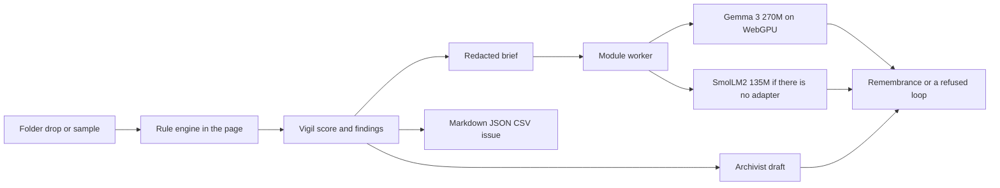

# Architecture

Veladora is a static site. The rule engine is the product. The model is a voice for a brief the rules already wrote.

## What crosses the network

| Bytes | When | Where they go |
| --- | --- | --- |
| The HTML, CSS, and scripts | First visit, then the service worker | This host |
| Transformers.js 4.2.0 | The first time you light a candle | jsDelivr |
| Model weights | The first time you light that model | Hugging Face, then the browser cache |
| Your files, secrets, and git names | Never | Nowhere |

There is no account, no analytics call, and no inference server.

## Why the brief is small

Gemma 3 270M loops and invents when it is handed a repository. The engine keeps at most eight findings, redacts secret values, and caps the brief at 1600 characters. Temperature is 0.6, with a repetition penalty and `no_repeat_ngram_size: 3`. A reply that fails `isGarbage` is discarded and the archivist draft is shown.

## Why there is no COOP/COEP

Cross-origin isolation would let the WASM fallback use more than one thread. It would also block the weight download unless every asset sent the right CORP header. The fast path is WebGPU. The CPU path is a smaller model, not a gigabyte of Gemma weights.

## Hosting

GitHub Pages, Vercel, and Render can all serve the repository root. There is no build. `vercel.json` sets a few headers. `render.yaml` is a static blueprint. `.github/workflows/pages.yml` publishes the root on every push to `main`.

Do not put `Cross-Origin-Embedder-Policy: require-corp` on the host. The model will fail to load.
